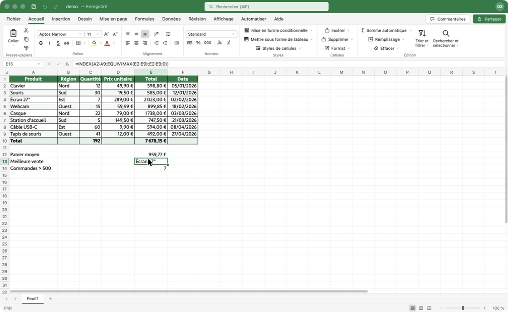
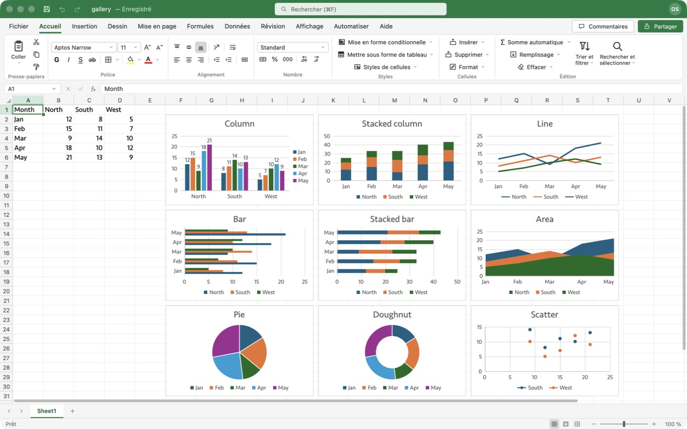

# OpenSheet

Un tableur open source qui reprend l'interface et le comportement d'Excel, écrit en Rust avec [GPUI](https://gpui.rs/).



> État : **v0.1, en développement actif**. La plupart des grandes fonctions d'Excel, hors macros, sont en place ; plusieurs restent partielles ou absentes — voir [Ce qui manque](#ce-qui-manque).

## Lancer

```bash
cargo run -p opensheet --release
```

Avec des données d'exemple :

```bash
cargo run -p opensheet --release -- --demo
```

Ouvrir un fichier :

```bash
cargo run -p opensheet --release -- chemin/vers/classeur.xlsx
```

Convertir sans ouvrir de fenêtre (le format suit l'extension : `.xlsx`, `.csv`, `.tsv`) :

```bash
cargo run -p opensheet --release -- classeur.xlsx --export classeur.csv
```

Créer une vraie application macOS (`target/release/OpenSheet.app`) :

```bash
cargo build -p opensheet --release && scripts/bundle.sh release
```

Prérequis : Rust stable récent et Xcode (GPUI compile ses shaders Metal). Développé et testé sur macOS.

### Langues

Cinq langues : français, anglais, espagnol, allemand, italien. L'interface **et** les formules suivent la langue choisie : `=SOMME(A1:A3;1,5)` en français, `=SUM(A1:A3,1.5)` en anglais, `=SUMME(A1:A3;1,5)` en allemand, `=SUMA(…)` en espagnol, `=SOMMA(…)` en italien — avec les séparateurs, les valeurs `VRAI` / `WAHR` / `VERDADERO`, les erreurs (`#VALEUR!`, `#WERT!`, `#¡VALOR!`) et les formats de date de chaque langue.

- Au démarrage, la langue du système est utilisée.
- Pour en changer : menu **Fichier**, en bas. Le choix est mémorisé.
- Pour forcer une langue au lancement : `OPENSHEET_LANG=de` (ou `fr`, `en`, `es`, `it`).

Les formules sont enregistrées sous forme canonique : un classeur saisi en français s'affiche en allemand sans rien perdre.

Toute l'interface est traduite dans les cinq langues (2 082 textes par langue), avec les termes d'Excel dans chacune. `python3 scripts/check_i18n.py` vérifie qu'aucun texte n'est oublié.

### Polices

Excel utilise Aptos Narrow par défaut, qui n'est pas une police système. Sans elle, OpenSheet affiche une police système de proportions proches (Seravek sur macOS). Deux façons d'obtenir le rendu exact :

- installer Aptos (téléchargement gratuit chez Microsoft) : elle est utilisée automatiquement ;
- ou, si Microsoft Office est installé sur la machine, lancer avec `OPENSHEET_OFFICE_FONTS=1` : les polices Aptos / Calibri de votre installation Office sont chargées à l'exécution (rien n'est copié ni redistribué — vérifiez que votre licence Office vous y autorise).

## Ce qui fonctionne

**Interface**
- Barre de titre, ruban à onglets (Accueil, Insertion, Mise en page, Formules, Données, Révision, Affichage…) avec ses onglets contextuels (tableau, tableau croisé, graphique, graphique croisé, segment, chronologie, forme, image), barre de formule avec zone Nom, onglets de feuilles, barre d'état avec Moyenne / Nb / Somme et zoom.
- Boîtes de dialogue, volets latéraux et menus contextuels d'Excel, dont Format de cellule et ses six onglets.
- Grille de 1 048 576 lignes × 16 384 colonnes, défilement fluide, zoom 10–400 %, volets figés.
- Préférences (⌘,) : général, affichage, modification, calcul, vérification des erreurs.
- Affichages personnalisés : enregistrer et rappeler lignes et colonnes masquées, filtre, mise en page, zoom et sélection.

**Saisie et sélection**
- Saisie directe, F2, double-clic, barre de formule ; Entrée / Tab / Échap ; reconnaissance des nombres, pourcentages, montants, dates et heures.
- Formules : références relatives / absolues, autres feuilles, plages colorées pendant la saisie, sélection des références à la souris ou au clavier, fermeture automatique des parenthèses.
- Sélection à la souris et au clavier (Maj, ⌘ pour les sélections multiples, ⌘+flèches, lignes et colonnes entières), Atteindre et Sélectionner les cellules (formules, vides, antécédents…).
- Copier / couper / coller, menu du bouton Coller et boîte Collage spécial : formules, valeurs, formats, largeurs de colonnes, opérations (ajouter, multiplier…), blancs non compris, transposer, coller avec liaison. Échange avec les autres applications en texte tabulé.
- Rechercher et remplacer : dans la feuille ou le classeur, dans les formules ou les valeurs, casse, cellule entière, Remplacer tout en une seule annulation.
- Liens hypertexte : page web, fichier, emplacement du classeur, adresse de courrier ; clic pour suivre, création automatique à la saisie d'une adresse.
- Poignée de recopie avec séries (nombres, dates, « Article 1 », jours, mois), double-clic pour recopier vers le bas, ⌘D / ⌘R.
- Annuler / rétablir sur toutes les opérations.

**Calcul**
- 337 fonctions : maths, statistiques, logique, texte, date et heure, recherche (RECHERCHEV, RECHERCHEX, INDEX, EQUIV…), finance, ingénierie.
- Tableaux dynamiques avec propagation (`=A1:A3*2`, `A1#`, FILTRE, TRIER, UNIQUE, SEQUENCE…) et erreur `#PROPAGATION!`.
- Noms définis (classeur ou feuille), références 3D (`Feuil1:Feuil3!A1`), références structurées (`Tableau1[Colonne]`), intersection et union.
- Recalcul par dépendances : seules les formules qui lisent une cellule modifiée sont recalculées. Modes Automatique et Manuel, Calculer maintenant (F9), Calculer la feuille (Maj+F9), indicateur « Calculer » dans la barre d'état.
- Références circulaires : avertissement d'Excel, cellule signalée dans la barre d'état, liste des références circulaires ; calcul itératif réglable dans les préférences (nombre d'itérations, écart maximal).
- Outils de formules : Gestionnaire de noms, Créer à partir de la sélection, Insérer une fonction et Arguments de la fonction, Afficher les formules, flèches d'antécédents et de dépendants, Vérification des erreurs, Évaluer la formule, Fenêtre Espion.

**Mise en forme**
- Police, taille, gras, italique, souligné, barré, couleurs de police et de remplissage, bordures, alignements, retrait, renvoi à la ligne, fusion.
- Formats de nombre Excel complets (codes personnalisés, sections, couleurs, dates, fractions, scientifique, comptabilité).
- Mise en forme conditionnelle : règles de surbrillance, valeurs hautes / basses, barres de données, nuances de couleurs, 20 jeux d'icônes, règles par formule, gestionnaire de règles.
- Styles de cellules : galerie des 49 styles d'Excel, styles personnalisés (nouveau, modifier, dupliquer, supprimer).
- Thèmes de document : les 29 thèmes d'Excel, jeux de couleurs et de polices, personnalisation ; les couleurs et polices « du thème » suivent un changement de thème dans les cellules, tableaux, graphiques et formes.
- Largeur / hauteur par glisser, ajustement automatique, masquer / afficher.

**Données**
- Filtres automatiques (valeurs, texte, nombres, dates, couleurs, 10 premiers), tri à plusieurs niveaux avec listes personnalisées, suppression des doublons.
- Tableaux structurés : 60 styles, ligne de total, colonnes calculées, agrandissement automatique à la saisie.
- Tableaux croisés dynamiques : volet des champs avec glisser-déposer, filtres, regroupements, « afficher les valeurs comme », styles, détail par double-clic, champs et éléments calculés, ordre de résolution.
- Segments (tableaux croisés et tableaux) et chronologies : sélection au clic ou par glisser, sélection multiple, connexions de rapport, styles ; les éléments sans données sont grisés.
- Graphiques croisés dynamiques : ils suivent la disposition, les filtres et l'actualisation du tableau croisé, avec leurs boutons de champ.
- Validation des données : tous les critères, liste déroulante dans la cellule, message de saisie, alertes, cercles autour des données non valides.
- Outils de données : Convertir (assistant en 3 étapes), remplissage instantané, filtre avancé, consolider (avec liaison aux données source).
- Plan : grouper / dissocier lignes et colonnes, niveaux et boutons + / − dans la marge, plan automatique, sous-total avec ses 11 fonctions.
- Analyse de scénarios : valeur cible, gestionnaire de scénarios avec feuille de synthèse, table de données.
- Import d'un fichier texte ou CSV, mémorisé dans le classeur et relu par Actualiser tout.

**Graphiques, images et formes**
- 37 types de graphiques : histogrammes, barres, courbes, aires, secteurs, anneau, nuage de points, bulles, radar, combinés, et leurs variantes 3D.
- Création depuis la sélection, sélection de chaque élément au clic, volet Format, axes secondaires, échelles manuelles, étiquettes, courbes de tendance, barres d'erreur, Sélectionner des données, Modifier le type de graphique.
- Disposition libre : titre, légende, zone de traçage, titres d'axes et étiquettes se déplacent à la souris ; mise en forme du texte de chaque élément ; couleur, épaisseur et tirets des quadrillages.
- Images (fichier, glisser-déposer, collage) et 15 formes avec texte : déplacement, redimensionnement, rotation, remplissage, contour, flèches.
- Objets : sélection multiple (Maj ou ⌘ + clic, Sélectionner les objets), aligner, répartir, grouper / dissocier, volet Sélection (renommer, masquer, réordonner) ; graphiques, images et formes partagent un seul ordre d'empilement.
- Images : rogner (marques, forme, proportions, remplir, ajuster), luminosité, contraste, saturation, nuance, recoloration, transparence, rétablir.
- Effets : ombre (9 préréglages), lueur, contours adoucis des images.
- Onglet Dessin : stylos, crayon, surligneur, gomme, sélection au lasso, conversion de l'encre en forme, relecture.
- Les graphiques suivent les données en direct, les insertions de lignes et les renommages de feuilles.
- Graphiques sparkline dans les cellules : courbe, histogramme, positif / négatif, 36 styles, points marqués, axes.



Un classeur d'exemple (133 graphiques sur 8 feuilles) se génère avec :

```bash
cargo run -p opensheet_io --example chart_gallery -- galerie.xlsx
```

**Révision**
- Notes (bulles jaunes) et commentaires en fil avec réponses et résolution, volet Commentaires.
- Protection de la feuille (15 autorisations, mot de passe, cellules verrouillées ou masquées) et de la structure du classeur.

**Mise en page et impression**
- Marges, orientation, papier, zone d'impression, sauts de page, titres à répéter, mise à l'échelle, en-têtes et pieds de page, arrière-plan de feuille.
- Vue Mise en page et Aperçu des sauts de page ; aperçu avant impression.
- Impression vers un fichier PDF (polices incorporées) ou vers Aperçu.

**Structure et fichiers**
- Insérer / supprimer lignes et colonnes (formules réécrites), feuilles multiples (ajouter, renommer, dupliquer, déplacer, couleur d'onglet).
- Ouvrir et enregistrer en `.xlsx` : valeurs, formules, styles et styles nommés, largeurs, fusions, volets figés, noms, graphiques, tableaux, filtres, mise en forme conditionnelle, validation, protection, notes et commentaires, mise en page, tableaux croisés dynamiques, images et formes, liens hypertexte, scénarios, tables de données, consolidation, imports de texte, plan, sparklines, thème du document, segments et chronologies, champs calculés, graphiques croisés, groupes d'objets, rognage et effets, disposition des graphiques, arrière-plan, encre, affichages personnalisés. Les fichiers produits s'ouvrent dans Excel sans réparation.
- Ouvrir et enregistrer en `.csv` et `.tsv`.

## Ce qui manque

**Hors périmètre** : l'exécution des macros VBA.

**Prévu** : les scripts Office en TypeScript (onglet Automatiser).

**Pas encore faits** (les boutons sont dans le ruban et affichent « pas encore disponible ») :
- Orthographe, traduction, statistiques du classeur, vérification d'accessibilité, équations, symboles, SmartArt, WordArt, icônes.
- Partage et co-édition.

**Partiels**
- Graphiques : une étiquette de données ne se sélectionne pas seule ; la zone de traçage des graphiques 3D ne se déplace pas.
- Tableaux croisés : pas de jeux (OLAP) ; les boutons de champ d'un graphique croisé n'ont pas de liste déroulante ; avec plusieurs champs de lignes, le graphique croisé n'a pas d'axe à plusieurs niveaux.
- Formes et images : un graphique n'entre pas dans un groupe ; les membres d'un groupe ne se sélectionnent pas un par un ; pas de styles d'image, d'effets artistiques, de reflet, de biseau ni de 3D ; le flou des ombres est approché ; les réglages de couleur et les effets ne sont pas imprimés.
- Dessin : l'encre est enregistrée sous forme de formes libres (Excel la rouvre comme des formes) ; elle n'est pas imprimée et reste au-dessus des autres objets.
- Préférences : les volets absents d'OpenSheet sont grisés (correction automatique, listes personnalisées, compatibilité…) ; pas de style de référence L1C1.
- Mise en page : l'impression passe par un PDF.
- Commentaires : pas de @mentions.
- Insérer une fonction : les descriptions des fonctions sont lues dans une installation d'Excel présente sur la machine ; sans elle, seule la syntaxe est affichée.
- Rechercher et remplacer : pas de « Rechercher tout » avec sa liste de résultats.
- Collage spécial : pas de collage en image ; un collage transposé ne reporte ni la mise en forme conditionnelle ni la validation.
- Obtenir des données : fichiers texte et CSV seulement (pas de bases de données, de web ni de Power Query).
- Sparklines : pas d'axe de dates. Plan : pas de styles automatiques ; la marge du plan n'apparaît pas en vue Mise en page.
- Thèmes : les effets sont enregistrés mais ne changent pas le dessin ; les jeux personnalisés ne durent que la session.
- Calcul : un fichier enregistré en mode manuel est recalculé une fois à l'ouverture.
- Ruban : quand la fenêtre est trop étroite pour un onglet (par exemple Formules en allemand dans une fenêtre de 1 390 points de large), le ruban défile horizontalement au lieu de replier ses groupes.

### Vitesse du recalcul

Mesures en mode release sur un classeur de 100 000 formules :

| Modification | Durée |
|---|---|
| Une cellule lue par deux formules, ou par aucune | 0,04 ms |
| Une cellule lue par toutes les formules | 51 ms |
| Premier calcul de 200 000 formules | environ 105 ms |

Le recalcul redevient complet dans quatre cas : feuille ajoutée, supprimée, renommée ou déplacée ; nom défini ou tableau modifié ; plus de la moitié des cellules changées d'un coup ; classeur contenant une référence circulaire.

Pour refaire les mesures :

```bash
cargo run -p opensheet_engine --release --example bench
```

## Architecture

```
crates/
  engine/   moteur de calcul, sans dépendance d'interface
            valeurs, analyseur de formules (localisé), évaluateur, 337 fonctions,
            formats de nombre, modèle de classeur, annuler/rétablir, opérations d'édition,
            et un module par fonctionnalité (filtres, tableaux, mise en forme conditionnelle,
            validation, commentaires, protection, mise en page, tableaux croisés, graphiques, formes)
  io/       lecture / écriture .xlsx et .csv
  print/    pagination et écriture PDF
  app/      l'application GPUI : ruban, grille peinte directement, éditeur de cellule,
            une interface par fonctionnalité dans src/features/
```

Les formules sont stockées sous forme canonique (noms anglais) et traduites à l'affichage et à la saisie ; un fichier écrit en français s'ouvre donc tel quel en anglais.

Tous les tests :

```bash
cargo test -p opensheet_engine -p opensheet_io -p opensheet_print -p opensheet
```

## Licence

MIT ou Apache-2.0, au choix.

OpenSheet est un projet indépendant, sans lien avec Microsoft. Excel est une marque de Microsoft Corporation.
