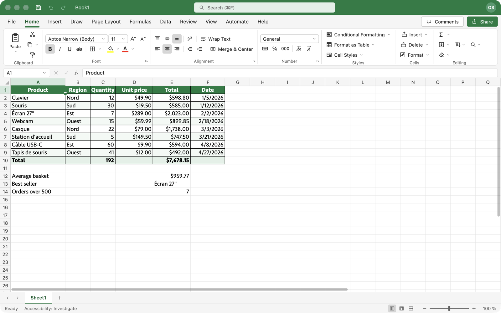

# OpenSheet

Un tableur open source qui reprend l'interface et le comportement d'Excel, écrit en Rust avec [GPUI](https://gpui.rs/).



> État : **v0.1, prototype fonctionnel**. Le cœur (grille, formules, mise en forme, fichiers) marche ; une grande partie d'Excel reste à faire — voir [Ce qui manque](#ce-qui-manque).

## Lancer

```bash
cargo run -p opensheet --release
```

Avec des données d'exemple :

```bash
cargo run -p opensheet --release -- --demo
```

Ouvrir un fichier :

```bash
cargo run -p opensheet --release -- chemin/vers/classeur.xlsx
```

Créer une vraie application macOS (`target/release/OpenSheet.app`) :

```bash
cargo build -p opensheet --release && scripts/bundle.sh release
```

Prérequis : Rust stable récent et Xcode (GPUI compile ses shaders Metal). Développé et testé sur macOS.

### Langue

L'interface et les formules suivent la langue du système : en français, `=SOMME(A1:A3;1,5)`, `VRAI`, `#VALEUR!`, dates `jj/mm/aaaa` ; en anglais, `=SUM(A1:A3,1.5)`. Forcer une langue : `OPENSHEET_LANG=fr` ou `OPENSHEET_LANG=en`.

### Polices

Excel utilise Aptos Narrow par défaut, qui n'est pas une police système. Sans elle, OpenSheet affiche une police système de proportions proches (Seravek sur macOS). Deux façons d'obtenir le rendu exact :

- installer Aptos (téléchargement gratuit chez Microsoft) : elle est utilisée automatiquement ;
- ou, si Microsoft Office est installé sur la machine, lancer avec `OPENSHEET_OFFICE_FONTS=1` : les polices Aptos / Calibri de votre installation Office sont chargées à l'exécution (rien n'est copié ni redistribué — vérifiez que votre licence Office vous y autorise).

## Ce qui fonctionne

**Interface**
- Barre de titre, ruban à onglets (Accueil, Insertion, Mise en page, Formules, Données, Révision, Affichage…), barre de formule avec zone Nom, onglets de feuilles, barre d'état avec Moyenne / Nb / Somme et zoom.
- Grille de 1 048 576 lignes × 16 384 colonnes, défilement fluide, zoom 10–400 %, volets figés.

**Saisie et sélection**
- Saisie directe, F2, double-clic, barre de formule ; Entrée / Tab / Échap ; reconnaissance des nombres, pourcentages, montants, dates et heures.
- Formules : références relatives / absolues, autres feuilles, plages colorées pendant la saisie, sélection des références à la souris ou au clavier, fermeture automatique des parenthèses.
- Sélection à la souris et au clavier (Maj, ⌘ pour les sélections multiples, ⌘+flèches, lignes et colonnes entières), zone Nom pour atteindre une cellule.
- Copier / couper / coller (formules décalées, valeurs seules, mise en forme seule), échange avec les autres applications en texte tabulé.
- Poignée de recopie avec séries (nombres, dates, « Article 1 », jours, mois), double-clic pour recopier vers le bas, ⌘D / ⌘R.
- Annuler / rétablir sur toutes les opérations.

**Calcul**
- Environ 400 fonctions : maths, statistiques, logique, texte, date et heure, recherche (RECHERCHEV, RECHERCHEX, INDEX, EQUIV…), finance, ingénierie.
- Tableaux dynamiques avec propagation (`=A1:A3*2`, FILTRE, TRIER, UNIQUE, SEQUENCE…) et erreur `#PROPAGATION!`.
- Détection des références circulaires.

**Mise en forme**
- Police, taille, gras, italique, souligné, barré, couleurs de police et de remplissage, bordures, alignements, retrait, renvoi à la ligne, fusion.
- Formats de nombre Excel complets (codes personnalisés, sections, couleurs, dates, fractions, scientifique, comptabilité).
- Largeur / hauteur par glisser, ajustement automatique, masquer / afficher.

**Structure et fichiers**
- Insérer / supprimer lignes et colonnes (formules réécrites), trier, feuilles multiples (ajouter, renommer, dupliquer, déplacer, couleur d'onglet).
- Ouvrir et enregistrer en `.xlsx` (valeurs, formules, styles, largeurs, fusions, volets figés) et `.csv`.

## Ce qui manque

Graphiques, tableaux croisés dynamiques, mise en forme conditionnelle, tableaux structurés, filtres automatiques, validation des données, commentaires, images et formes, impression et mise en page, boîte de dialogue Format de cellule, gestionnaire de noms, protection, macros (hors périmètre pour l'instant). Les boutons correspondants sont présents dans le ruban mais affichent « pas encore disponible ».

Le recalcul est complet à chaque modification (pas encore de graphe de dépendances) : environ 0,15 s pour 200 000 formules en mode release, ce qui deviendra sensible sur de très gros classeurs.

## Architecture

```
crates/
  engine/   moteur de calcul, sans dépendance d'interface
            valeurs, analyseur de formules (localisé), évaluateur, ~400 fonctions,
            formats de nombre, modèle de classeur, annuler/rétablir, opérations d'édition
  io/       lecture / écriture .xlsx et .csv
  app/      l'application GPUI : ruban, grille peinte directement, éditeur de cellule
```

Les formules sont stockées sous forme canonique (noms anglais) et traduites à l'affichage et à la saisie ; un fichier écrit en français s'ouvre donc tel quel en anglais.

Tests du moteur :

```bash
cargo test -p opensheet_engine -p opensheet_io
```

## Licence

MIT ou Apache-2.0, au choix.

OpenSheet est un projet indépendant, sans lien avec Microsoft. Excel est une marque de Microsoft Corporation.
